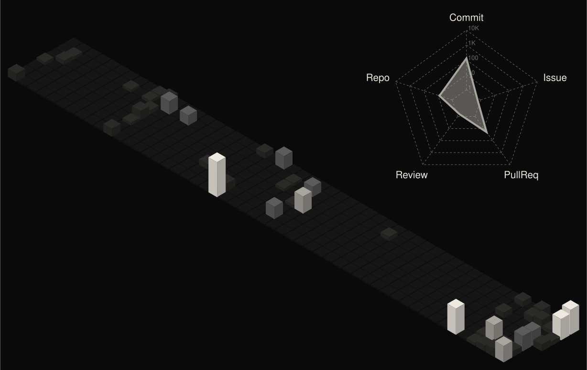

  <picture>
    <source media="(prefers-color-scheme: light)" srcset="assets/header-light.svg" />
    
  </picture>

  <picture>
    <source media="(prefers-color-scheme: light)" srcset="assets/stats-light.svg" />
    
  </picture>

  <picture>
    <source media="(prefers-color-scheme: light)" srcset="profile-3d-contrib/profile-skyline-light.svg" />
    
  </picture>

  <a href="https://github.com/aryank09">github.com/aryank09</a>
  · <a href="https://www.linkedin.com/in/aryankhanna9/">LinkedIn</a>
  · Washington

